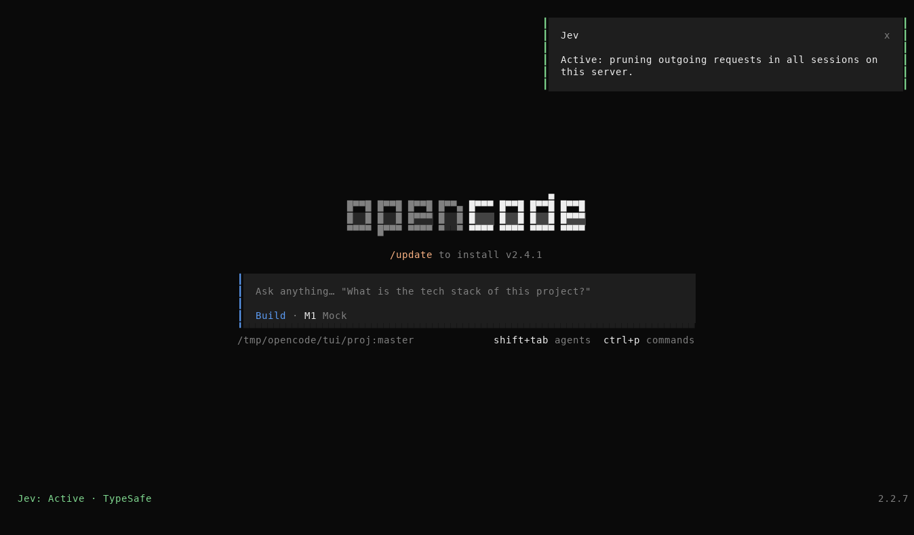
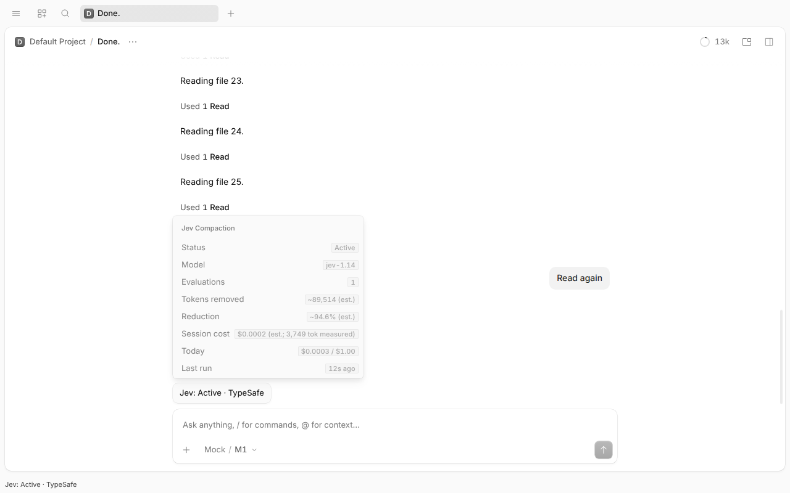

# Jev Compaction for OpenCode

An optional plugin for [OpenCode](https://opencode.ai) 2.2.7 that trims stale tool output from the context sent to your coding model. It uses [TypeSafe](https://typesafe.ai)'s Jev evaluation model to decide which old tool calls and results are no longer needed. Instructions, conversation text and recent work are kept verbatim, and OpenCode's stored conversation history is never modified.

It does not replace your coding model or provider, and it does not make coding-model access free. Jev evaluations are a separate paid service.

> Status: **0.1.0, development release.** Tested on OpenCode 2.2.7 only. Real-world cost savings have not been measured yet (see [Benchmarks](#benchmarks)).

This is an OpenCode port of [fast-jev-compaction](https://github.com/tamaratran/fast-jev-compaction) (MIT, by GitHub user `tamaratran`), originally a Claude Code plugin. GeekCubo maintains this port. It is not affiliated with, or endorsed by, TypeSafe or the OpenCode project.

## Features

- **Automatic evaluation.** Once a session's context passes a threshold, Jev scores each stale tool call and result as keep, truncate, or drop.
- **Non-destructive.** Pruning applies only to the outgoing model request. Stored history is untouched, and kept content stays verbatim.
- **Context protection.** Protected categories are never offered to Jev (see [Context protection](#context-protection)).
- **Recovery.** `/jev-reset` restores the full context of the current session.
- **Modes.** Active, dry-run or disabled. The mode applies to the whole OpenCode service and persists.
- **TUI and Desktop.** Slash commands, toasts and dialogs in both clients, plus status indicators: a welcome-screen label in both, a sidebar section in the TUI, and a status pill in Desktop.
- **Statistics.** Per-session and overall statistics, with measured figures kept separate from estimates.
- **Cost controls.** Per-session and per-day spending limits, a price cap, a cooldown, a growth gate, bounded retries and timeouts.
- **Native compaction preserved.** OpenCode's own `/compact` and automatic compaction are unchanged and remain the fallback.
- **Providers.** TypeSafe Direct is the default; OpenCode Zen is optional. Provider-independent by design: it edits OpenCode's provider-neutral message format, and the unit tests exercise several provider IDs. End-to-end tests used a mock OpenAI-compatible provider only.
- **Replaceable backend.** The evaluator sits behind a small interface (see [docs/ARCHITECTURE.md](docs/ARCHITECTURE.md)).

## Screenshots

Synthetic demo sessions with a mock coding model. TUI images are rendered from exact terminal captures; Desktop images are real screenshots of the OpenCode Desktop app.

| TUI welcome screen | TUI session sidebar |
|---|---|
|  |  |

| Desktop welcome screen | Desktop session status pill | Desktop `/jev-status` |
|---|---|---|
|  |  |  |

## Quick start

Requirements:
- OpenCode 2.2.7 (TUI and/or Desktop).
- A TypeSafe account and API key.
- Git.

No npm package has been published; install from a checkout.

```sh
# 1. Get the plugin. Any location outside ~/.config/opencode/plugins works; that folder auto-loads plugins.
git clone https://github.com/GeekCubo/jev-opencode.git ~/.local/share/opencode-plugins/jev-opencode

# 2. Store your TypeSafe key in a file readable only by you (never in opencode.jsonc).
umask 077
printf '%s' 'YOUR_TYPESAFE_KEY' > ~/.config/opencode/typesafe-api-key
```

3. Add the plugin to the `plugins` array of `~/.config/opencode/opencode.jsonc`. Use an absolute path; the Desktop app loads plugins from the global config only.

```jsonc
{
  "$schema": "https://opencode.ai/config.json",
  "plugins": [
    {
      "package": "/home/YOUR_USER/.local/share/opencode-plugins/jev-opencode/plugin",
      "options": { "mode": "dry-run" }
    }
  ]
}
```

4. OpenCode reloads its config automatically. Run `/reload` in an open TUI or reopen the Desktop window, then run `/jev-status`.

The prebuilt Desktop bundle (`plugin/dist/gui-experimental.cjs`) is included, so no build step is needed. See [INSTALL.md](INSTALL.md) for building from source, upgrading and removal.

## TypeSafe Direct

- **Account and charges.** You need your own TypeSafe account and key. Jev evaluations are billed by TypeSafe, separately from your coding-model provider. The plugin's price table lists `jev-1.14` at $0.042 per million input tokens, with free output. Check TypeSafe's current pricing.
- **Key lookup.** `TYPESAFE_API_KEY`, then `~/.config/opencode/typesafe-api-key`. Keys are never read from plugin options, never logged, and must never be committed.
- **Model name.** You configure `"model": "jev-1.14"`. The plugin sends `jev-1.14.0` to TypeSafe Direct (`https://api.typesafe.ai/v1/systemone`), because the direct API rejects the unversioned alias.

## OpenCode Zen (optional)

```jsonc
"options": { "mode": "dry-run", "endpoint": "opencode-zen" }
```

- **Endpoint and model.** Sends `jev-1.14` to `https://opencode.ai/inference/systemone/v1/systemone`.
- **Key lookup.** `OPENCODE_API_KEY`, then your stored OpenCode (`opencode`) credential, then `~/.config/opencode/opencode-zen-api-key`.
- **Separate from TypeSafe Direct.** A Zen account is not needed for TypeSafe Direct. There is no automatic failover between the two endpoints.
- **Testing.** The Zen endpoint is covered by unit tests only; no live request to Zen has been made.

## Operating modes

| Mode | Behaviour |
|---|---|
| `dry-run` (default) | Jev evaluates eligible sessions and records statistics. Requests are **not** modified. |
| `active` | Jev evaluates, and its decisions are applied to outgoing requests. |
| `off` | No evaluations and no pruning. |

- **Dry-run is billed.** It still sends evaluation data to the provider, and those evaluations are charged.
- **Start in dry-run.** New installations default to dry-run. Switch to active (`/jev-enable`) only after checking `/jev-stats`.
- **Mode scope.** The mode applies to **every session and project on the same OpenCode service**. It is stored in plugin storage and survives reloads and restarts. The `mode` option sets the initial value, and a mode chosen by command takes precedence, except that `"mode": "off"` in config always wins.

## Configuration reference

All options go in `options` of the plugin entry. Invalid options disable the plugin with a logged reason.

| Option | Default | Meaning |
|---|---|---|
| `mode` | `"dry-run"` | Initial mode: `dry-run` or `active`; a mode chosen by command overrides it. `"off"` (or `{ "compaction": { "enabled": false } }`) is a kill switch that overrides any stored mode and blocks the mode commands. |
| `endpoint` | `"typesafe"` | `typesafe` or `opencode-zen`. |
| `url` | (from endpoint) | Endpoint override. Must be https (plain http only for localhost testing). |
| `model` | `"jev-1.14"` | Jev model. Known prices: `jev-1.14`, `jev-1.13`. |
| `approvedPricePerMTok` | none | Required to use a model with no known price, in USD per 1M input tokens. |
| `maxPricePerMTok` | `1.5` | Price cap in USD per 1M tokens. The hard maximum is 1.5. |
| `compactAtTokens` | `60000` | Absolute evaluation threshold, in estimated tokens. |
| `compactAtContextFraction` | `0.6` | Relative threshold. The effective threshold is `min(compactAtTokens, fraction × context window)`. |
| `keepThreshold` | `0.5` | Minimum Jev keep probability (0–1). |
| `minReductionRatio` | `0.15` | Minimum reduction needed to apply decisions; otherwise native compaction stays in charge. |
| `minGrowthTokens` | `8000` | Context growth required before a new evaluation. |
| `cooldownMs` | `60000` | Minimum time between evaluations of one session. |
| `preserveRecentMessages` | `6` | The newest N messages are never touched. |
| `truncateHeadChars` | `300` | Characters kept from a truncated result. |
| `maxStateTokens` / `maxRequestTokens` | `25000` / `30000` | Size limits for one Jev request. |
| `timeoutMs` | `20000` | Timeout per Jev HTTP request. |
| `maxRetries` | `2` | Retries per Jev request, for transient errors only. |
| `budget.perSessionUSD` | `0.25` | Estimated Jev spend allowed per session. |
| `budget.perDayUSD` | `1` | Estimated Jev spend allowed per UTC day, shared by all sessions. |
| `nativeFallback` | `true` | Recorded in statistics. Native compaction always remains active. |
| `fallbackCompactionModel` | unset | Optional `provider/model` for OpenCode's native summary agent only. Off unless you set it. |
| `protectTools` | `[]` | Extra regexes for tool names that are never pruned. |
| `logDecisions` | `false` | Logs call ids, tool names and actions only (no content). |
| `serverCommands` | `false` | Also registers server-side `/jev-*` commands for clients without the TUI or Desktop part. Their output shows as an error notice; not recommended. |
| `routing` | n/a | Not supported. `routing.enabled: true` is rejected. |

## Commands

| Command | Purpose | Needs a session |
|---|---|---|
| `/jev-enable` | Active mode for all sessions | no |
| `/jev-dry-run` | Dry-run mode for all sessions | no |
| `/jev-disable` | Turn Jev off for all sessions | no |
| `/jev-status` | Show mode, thresholds and budget (dialog) | no (more detail in a session) |
| `/jev-stats` | Show statistics (dialog) | no (session section only in a session) |
| `/jev-reset` | Restore the full context of the current session | yes |
| `/jev-compact` | Evaluate the current session on its next request, ignoring threshold and cooldown but not the budget | yes |

- **Without a session.** Session commands run outside a session show a warning and do nothing.
- **No conversation side effects.** Commands never call a model or Jev and never add messages to the conversation.
- **Not the same as `/compact`.** `/jev-compact` is separate from OpenCode's native `/compact`, which summarizes the conversation and is unchanged.
- **Session-wide reset only.** Restoring an individual tool result is not supported; `/jev-reset` restores the whole session.

The same statistics are available outside OpenCode:

```sh
node --experimental-strip-types --no-warnings plugin/cli.ts [sessionID]
```

The CLI reads `$XDG_STATE_HOME/opencode-jev/stats.json` (default `~/.local/state/…`), a snapshot written by the plugin (mode 600, counters only). Budgets and the daily total come from plugin storage; see [docs/ACCOUNTING.md](docs/ACCOUNTING.md).

## Context protection

The following are never offered to Jev, and never removed or altered:

- **Messages.** System messages, and all user and assistant text.
- **Position.** The first message and the newest `preserveRecentMessages` messages.
- **Tool types.** Edit, write, patch, create, delete, move and rename calls; todo, task, plan, question, skill, subagent, goal and memory calls; plus `protectTools`.
- **Instruction files.** Reads of AGENTS.md, CLAUDE.md, README, CONTRIBUTING, SECURITY, `opencode.json(c)`, and files whose names mention spec, plan, requirements or acceptance.
- **Recent failures.** Results containing errors or failing tests within the last 20 messages.
- **Named files.** Files named in the latest user prompt.

Integrity rules:
- A tool result is never sent without its call. If the integrity check fails, the original request is sent instead.
- Message order never changes, and kept content is byte-identical.

These rules reduce risk but cannot guarantee that every useful piece of old context is kept. Jev's scores are probabilities. If something important was pruned, the model can re-run the tool, or you can run `/jev-reset`.

## Recovery and native compaction

- **History stays intact.** Stored conversation history is never changed; pruning affects only the outgoing request.
- **Reset.** `/jev-reset` clears the current session's decisions. The next request carries the full stored context, subject to OpenCode's own context management. Restored calls are not re-evaluated or re-billed. Other sessions, statistics and budgets are unaffected.
- **Plugin reload.** A reload clears all in-memory pruning decisions, so every session's full context returns. Statistics and spend persist.
- **Native compaction.** It remains available and unchanged. After it runs, Jev's decisions for that session are discarded. Jev cannot recover content that native compaction summarized away.

## Failure handling

When Jev cannot safely evaluate, the request goes out **unpruned**, and normal coding continues.

| Situation | Behaviour |
|---|---|
| TypeSafe unavailable: HTTP 408, 429, 500, 502, 503, 504, 529, or a network error | Up to `maxRetries` retries, honouring a numeric `Retry-After` in seconds (capped at 30 s), otherwise exponential backoff with jitter. |
| Timeout | Each attempt is aborted after `timeoutMs`, then retried as above. |
| Authentication error, other 4xx (e.g. unknown model) or other 5xx | No retry. A warning is logged and the request goes out unpruned. |
| Invalid response | Treated as a failure; the request goes out unpruned. |
| Budget reached | No Jev request is made. Status shows "Budget reached". |
| Unknown or over-cap model price | Jev is blocked. Status shows "Unavailable". |
| OpenCode lacks `session.hook`, or registering the `context` hook fails | One warning, status "Unavailable", requests untouched; the mode commands report it. |
| Optional hooks fail to register (`compaction`, `generate`, agent transform) or UI slots are missing | Each is skipped with a warning; everything else keeps working. |

With the defaults, a failing evaluation can delay one model request by up to about 3 × 20 s plus backoff. That happens only on turns where an evaluation is due, not on every request.

## Privacy and security

**Sent to TypeSafe or Zen for each evaluation:**
- conversation text (user and assistant);
- tool names;
- tool inputs, shortened to at most about 1,000 characters;
- a one-line size note per tool result.

Tool **outputs are not sent**. Anything OpenCode places in user or assistant text (for example, content attached to a prompt) is conversation text and is sent.

**Redaction.** Before sending, every string goes through regex redaction covering:
- bearer and authorization headers, and private keys;
- `sk-`, `ghp_`, `xox` and AWS/Google key formats, and JWTs;
- `user:pass@` URLs;
- `*_KEY`, `*_TOKEN`, `*_SECRET` and `*_PASSWORD` assignments;
- JSON `api_key`, `token` and `password` fields.

Redaction is **best effort**: secrets in other formats, or written in prose, can still be sent.

**Stored locally:**
- the mode, statistics and spend counters, in OpenCode plugin storage;
- a counters-only snapshot in `$XDG_STATE_HOME/opencode-jev/stats.json` (default `~/.local/state/…`, mode 600).

Transcripts are never logged.

Jev is an external service, and this plugin is not local or offline while active or in dry-run. Check your organization's data-handling rules before enabling it. See [SECURITY.md](SECURITY.md).

## Compatibility

| Version | Status |
|---|---|
| OpenCode 2.2.7: server, TUI and Desktop | Tested |
| OpenCode 2.3 – 2.4.1 | Untested |
| OpenCode 1.x | Unsupported |
| Future releases | Not guaranteed |

- **Desktop part.** It uses OpenCode's experimental GUI plugin API. Desktop 2.2.7 has no sidebar extension point, so session details appear in a status pill above the message box.
- **More detail.** See [COMPATIBILITY.md](COMPATIBILITY.md).

## Troubleshooting

| Problem | Fix |
|---|---|
| `/jev-…` commands missing | Run `/reload` in the TUI, or reopen the Desktop window. Check that the plugin entry is in the **global** config, uses an absolute path, and that `/jev-status` works. |
| No status indicator | Same as above. Indicators need TUI slots or the Desktop GUI part. If they're missing, commands still work. |
| Desktop shows no Jev indicator or commands, but the TUI does | The Desktop app loads GUI parts only from the **global** config, through its own background service. In isolated testing on 2.2.7, a GUI part added while that service was already running wasn't picked up until the service restarted (`opencode service restart`, which interrupts running sessions). |
| No evaluations | Context is below `min(compactAtTokens, 0.6 × window)`, or it hasn't grown by `minGrowthTokens`, or the cooldown is active, or the mode is `off`. Use `/jev-compact` to force one. |
| "Unavailable" status | Unknown or over-cap model price, missing hook, or no API key. Check `/jev-status` and the OpenCode log for `[jev]` lines. |
| Invalid key or unknown model | Look for `[jev] … Jev HTTP 401/403/400` in the log. Fix the key file or the model name. |
| "Budget reached" | Wait for the next UTC day, or raise `budget.*`. |
| TypeSafe outage | Nothing to do: requests go out unpruned. Optionally run `/jev-disable` to avoid retry delays. |
| Something important seems missing | `/jev-reset` in that session. |
| Unsupported OpenCode version | Run `/jev-disable`, or remove the plugin entry. |

## Uninstall

1. Remove the plugin entry from `plugins` in `opencode.jsonc`. OpenCode reloads automatically. (To keep it installed but stop all Jev requests, set `"mode": "off"` instead.)
2. Optionally delete the checkout, `~/.config/opencode/typesafe-api-key` and `~/.local/state/opencode-jev/`.

This does not touch conversations, projects, provider credentials or other plugins. Plugin storage (mode and counters) stays inert inside OpenCode's database.

## Benchmarks

These are preliminary results under controlled conditions. They are **not** billing measurements.

- **Mock coding run.**
  - Setup: OpenCode 2.2.7 with a mock coding model performing 32 steps that read about 13 KB files, against a mock Jev that drops old file reads.
  - Results: cumulative outgoing request data was 6,717 KB with Jev off, 6,717 KB in dry-run, and 2,197 KB in active mode (about 67.3% less).
  - Caveat: the mock evaluator's decisions don't represent real workloads, and request bytes are not billed tokens.
- **Live TypeSafe, synthetic transcript.**
  - Setup: a 12-tool-call transcript evaluated by `jev-1.14` (2026-11-25).
  - Estimated tokens: 20,342 → 8,401 (11,941 removed, about 58.7%).
  - Characters: the same run measured 76,795 → 32,382 characters (57.8%). The two methods measure different things and shouldn't be mixed.
- **Latency.** TypeSafe latency in that live test was a median of 341 ms (min 286, max 620) over 3 full-evaluation requests. Separately, a small sanity request took 630 ms. The sample is tiny.
- **Tests.** 85 automated tests pass; 6 are skipped by default (5 opt-in live tests and 1 upstream HTTP-client test).

### Real-world coding benchmark: pending

No A/B comparison on real coding tasks has been completed, so there is no evidence yet about real bill reduction, cache effects or coding quality. The protocol is in [benchmarks/README.md](benchmarks/README.md).

## Credits and license

- **Original project.** [fast-jev-compaction](https://github.com/tamaratran/fast-jev-compaction), the Claude Code plugin and pruning algorithm, by GitHub user `tamaratran`. MIT license. The adapted source is in `plugin/upstream/` with its licence and change notes.
- **OpenCode port.** Maintained by [GeekCubo](https://geekcubo.com). MIT license (see [LICENSE](LICENSE) and [NOTICE](NOTICE)).
- **Jev** is TypeSafe's proprietary evaluation model and API. **OpenCode** is an independent project. Neither is owned by or affiliated with GeekCubo.
