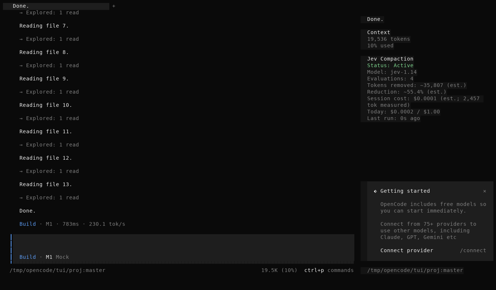
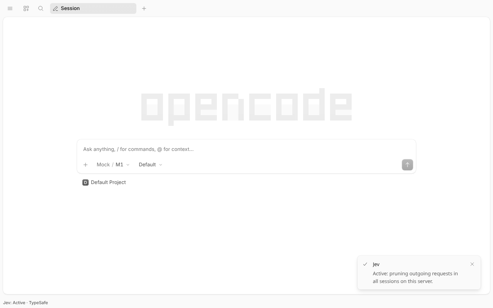
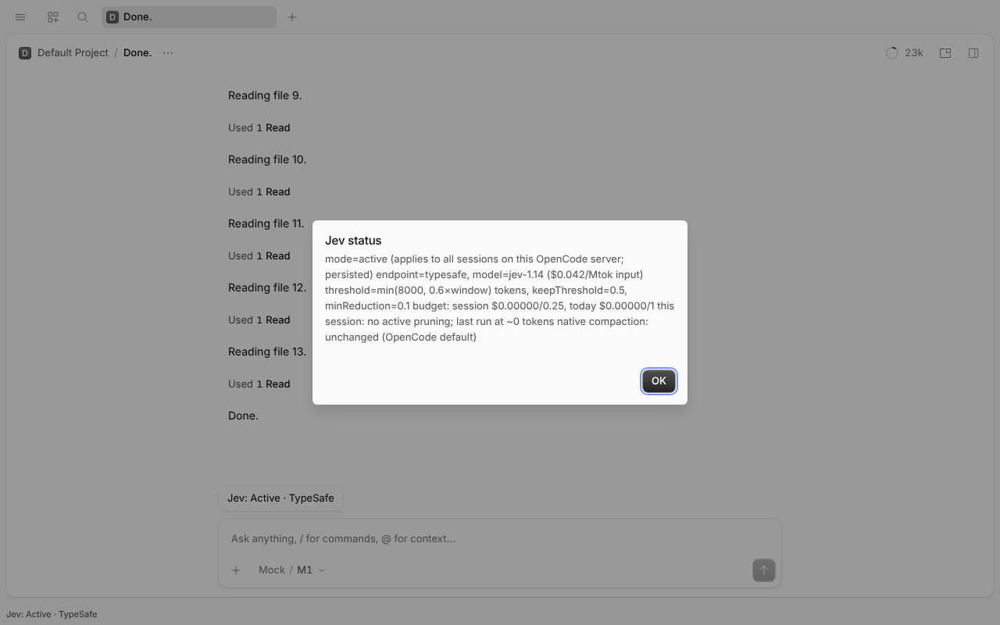
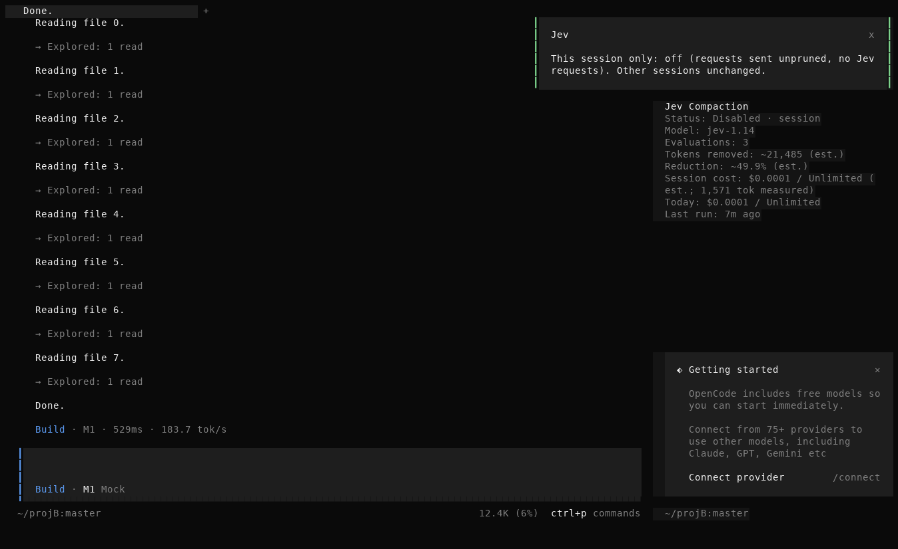
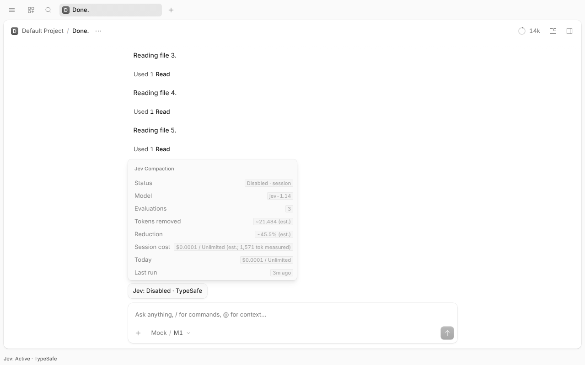
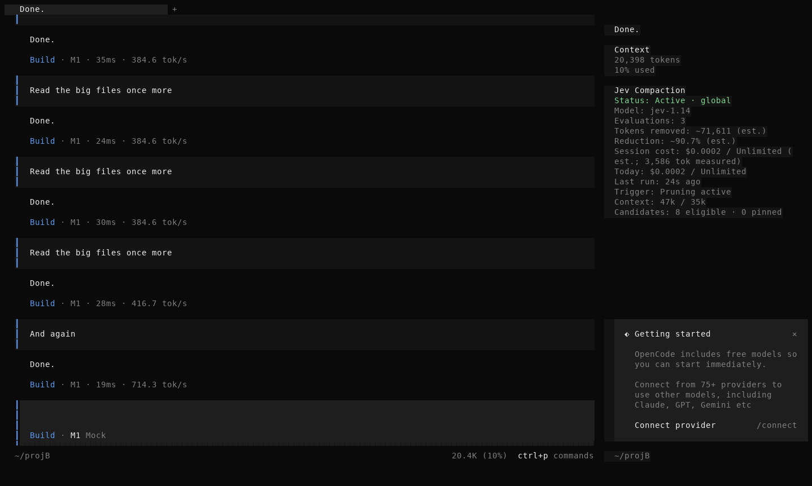
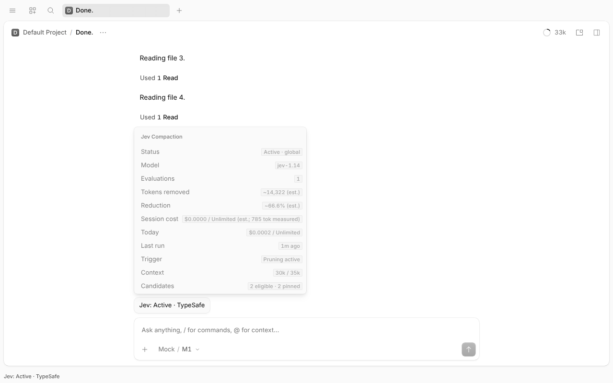

# Jev Compaction for OpenCode

An optional plugin for [OpenCode](https://opencode.ai) that trims stale tool output from the context sent to your coding model. It uses [TypeSafe](https://typesafe.ai)'s Jev evaluation model to decide which old tool calls and results are no longer needed. Instructions, conversation text and recent work are kept verbatim, and OpenCode's stored conversation history is never modified.

It does not replace your coding model or provider, and it does not make coding-model access free. Jev evaluations are a separate paid service.

> **Requires OpenCode v2.2.7 or newer.** Version 0.3.0. Real-world cost savings have not been measured (see [Benchmarks](#benchmarks)).
>
> npm: [`jev-compaction`](https://www.npmjs.com/package/jev-compaction) · GitHub: [GeekCubo/jev-opencode](https://github.com/GeekCubo/jev-opencode)

This is an OpenCode port of [fast-jev-compaction](https://github.com/tamaratran/fast-jev-compaction) (MIT, by GitHub user `tamaratran`), originally a Claude Code plugin. GeekCubo maintains this port. It is not affiliated with, or endorsed by, TypeSafe or the OpenCode project.

## Features

- **Automatic evaluation.** Once a session's context passes a threshold, Jev scores each stale tool call and result as keep, truncate, or drop.
- **Non-destructive.** Pruning applies only to the outgoing model request. Stored history is untouched, and kept content stays verbatim.
- **Context protection.** Protected categories are never offered to Jev (see [Context protection](#context-protection)).
- **Recovery.** `/jev-reset` restores the full context of the current session.
- **Modes.** Active, dry-run or disabled: a global default for the whole OpenCode service, plus optional per-session overrides. Both persist.
- **TUI and Desktop.** Slash commands, toasts and dialogs in both clients, plus status indicators: a welcome-screen label in both, a sidebar section in the TUI, and a status pill in Desktop.
- **Statistics.** Per-session and overall statistics, persisted across reloads and restarts, with measured figures kept separate from estimates.
- **Cost controls.** Optional per-session and per-day spending limits (each can be unlimited), shared across all projects; a price cap, a cooldown, a growth gate, bounded retries and timeouts.
- **Native compaction preserved.** OpenCode's own `/compact` and automatic compaction are unchanged and remain the fallback.
- **Providers.** TypeSafe Direct is the default; OpenCode Zen is optional. Provider-independent by design: it edits OpenCode's provider-neutral message format, and the unit tests exercise several provider IDs. End-to-end tests used a mock OpenAI-compatible provider only.
- **Replaceable backend.** The evaluator sits behind a small interface (see [docs/ARCHITECTURE.md](docs/ARCHITECTURE.md)).

## Screenshots

Synthetic demo sessions with a mock coding model. TUI images are rendered from exact terminal captures; Desktop images are real screenshots of the OpenCode Desktop app.

| TUI welcome screen | TUI session sidebar |
|---|---|
|  |  |

| Desktop welcome screen | Desktop session status pill | Desktop `/jev-status` |
|---|---|---|
|  |  |  |

| TUI session override (sidebar shows `Disabled · session`) | Desktop: session override in the pill while the global mode (bottom strip) stays Active |
|---|---|
|  |  |

| TUI trigger diagnostics (0.2.1) | Desktop trigger diagnostics (0.2.1) |
|---|---|
|  |  |

## Why compaction

Long coding sessions accumulate tool output — file reads, search results, command logs — that the model no longer needs but that is still sent with every request. That inflates request size, can push a session toward the model's context limit sooner, and can trigger OpenCode's native compaction earlier. Jev removes stale tool output from the outgoing request while leaving instructions, conversation text and recent work intact. Whether this lowers your bill depends on your provider, caching and workload; it has not been measured on real coding tasks (see [Benchmarks](#benchmarks)).

## Quick start

Requirements:
- **OpenCode v2.2.7+** (TUI and/or Desktop).
- A TypeSafe account and API key (or an OpenCode Zen account; see [OpenCode Zen](#opencode-zen-optional)).

No cloning, building or separate service is needed: OpenCode installs the npm package itself.

1. Store your TypeSafe key in a file readable only by you (never in `opencode.jsonc`):

   ```sh
   umask 077
   printf '%s' 'YOUR_TYPESAFE_KEY' > ~/.config/opencode/typesafe-api-key
   ```

   Alternatively, set `TYPESAFE_API_KEY` in the environment of the OpenCode service.

2. Add the plugin to the `plugins` array of your **global** configuration, `~/.config/opencode/opencode.jsonc` (the Desktop app loads plugins from the global config only). Keep all other settings.

   Latest published version:

   ```jsonc
   {
     "$schema": "https://opencode.ai/config.json",
     "plugins": [
       { "package": "jev-compaction", "options": { "mode": "dry-run" } }
     ]
   }
   ```

   Pinned to this release:

   ```jsonc
   "plugins": [
     { "package": "jev-compaction@0.3.0", "options": { "mode": "dry-run" } }
   ]
   ```

   On OpenCode v2.4.2 you can also run `opencode plugin add jev-compaction` (or `jev-compaction@0.3.0`), which installs the package and adds it to the global configuration; then add the `options` shown above.

3. OpenCode reloads its config automatically. Run `/reload` in an open TUI or reopen the Desktop window, then run `/jev-status`: it shows the Jev version and `mode=dry-run`.

4. When the dry-run figures look right, switch to active mode with `/jev-enable` (or `"mode": "active"`).

The prebuilt Desktop bundle (`dist/gui-experimental.cjs`) is included in the package. To work on the plugin itself, see [INSTALL.md](INSTALL.md) (checkout installation, building from source).

### Upgrade, disable, uninstall, rollback

- **Upgrade.** With an unpinned `"jev-compaction"` entry, OpenCode resolves the latest published version (on v2.4.2, `opencode plugin update jev-compaction`). With a pinned entry, change the version in the specifier.
- **Disable.** `/jev-disable` (all sessions) or `/jev-session-disable` (one session), or set `"mode": "off"`. Requests then go out unchanged.
- **Uninstall.** Remove the entry from `plugins` (on v2.4.2, `opencode plugin remove jev-compaction`). See [Uninstall](#uninstall) for the files Jev leaves behind.
- **Rollback.** Pin the previous version (e.g. `"jev-compaction@0.2.4"` if you used it from a checkout, point back to that checkout). Your configuration and conversations are not modified by Jev, so nothing else needs restoring. If you applied `/jev-setup`, its backup (shown when it was applied) restores the previous agent configuration.

## TypeSafe Direct

- **Account and charges.** You need your own TypeSafe account and key. Jev evaluations are billed by TypeSafe, separately from your coding-model provider. The plugin's price table lists `jev-1.14` at $0.042 per million input tokens, with free output. Check TypeSafe's current pricing.
- **Key lookup.** `TYPESAFE_API_KEY`, then `~/.config/opencode/typesafe-api-key`. Keys are never read from plugin options, never logged, and must never be committed.
- **Model name.** You configure `"model": "jev-1.14"`. The plugin sends `jev-1.14.0` to TypeSafe Direct (`https://api.typesafe.ai/v1/systemone`), because the direct API rejects the unversioned alias.

## OpenCode Zen (optional)

```jsonc
"options": { "mode": "dry-run", "endpoint": "opencode-zen" }
```

- **Endpoint and model.** Sends `jev-1.14` to `https://opencode.ai/inference/systemone/v1/systemone`.
- **Key lookup.** `OPENCODE_API_KEY`, then your stored OpenCode (`opencode`) credential, then `~/.config/opencode/opencode-zen-api-key`.
- **Separate from TypeSafe Direct.** A Zen account is not needed for TypeSafe Direct. There is no automatic failover between the two endpoints.
- **Testing.** The Zen endpoint is covered by unit tests only; no live request to Zen has been made.

## Operating modes

| Mode | Behaviour |
|---|---|
| `dry-run` (default) | Jev evaluates eligible sessions and records statistics. Requests are **not** modified. |
| `active` | Jev evaluates, and its decisions are applied to outgoing requests. |
| `off` | No evaluations and no pruning. |

- **Dry-run is billed.** It still sends evaluation data to the provider, and those evaluations are charged.
- **Start in dry-run.** New installations default to dry-run. Switch to active (`/jev-enable`) only after checking `/jev-stats`.
- **Mode scope.** The mode applies to **every session and project on the same OpenCode service**. It is stored in plugin storage and survives reloads and restarts. The `mode` option sets the initial value, and a mode chosen by command takes precedence, except that `"mode": "off"` in config always wins.

### Global mode and session overrides

The effective mode of a session is decided in this order:
1. **Config kill switch.** `"mode": "off"` (or `enabled: false`) in `opencode.jsonc` wins over everything, and the mode commands report that they can't change it.
2. **Session override,** set with `/jev-session-enable`, `/jev-session-dry-run` or `/jev-session-disable`. It applies only to that session and persists across reloads and restarts.
3. **Global mode,** set with `/jev-enable`, `/jev-dry-run` or `/jev-disable`. It is the default for every other session, including new ones.

Changing the global mode leaves existing overrides in place. `/jev-session-inherit` removes a session's override. Changing a session's mode discards its in-memory pruning decisions, so a re-enabled session starts clean rather than reusing old decisions. Indicators show where the mode came from (`· global`, `· session` or `· config`).

### Spending limits

- **Optional.** Each limit is a number in USD, or `null` for **unlimited**: `"budget": { "perDayUSD": null, "perSessionUSD": 0.25 }`. No other value means unlimited, and invalid values disable the plugin with a logged reason.
- **Defaults for new installs:** $1.00 per day and $0.25 per session.
- **Spend is always tracked,** even when unlimited. Indicators show `$X / Unlimited`.
- **When a limit is reached,** Jev stops starting new paid evaluations, and the status shows "Budget reached". The coding session continues, and pruning decisions already made for that session keep being applied.
- **Unaffected by limits:** failure protection, retries, cooldowns and concurrency limits apply whether or not limits are set.

## Configuration reference

All options go in `options` of the plugin entry. Invalid options disable the plugin with a logged reason.

| Option | Default | Meaning |
|---|---|---|
| `mode` | `"dry-run"` | Initial mode: `dry-run` or `active`; a mode chosen by command overrides it. `"off"` (or `{ "compaction": { "enabled": false } }`) is a kill switch that overrides any stored mode and blocks the mode commands. |
| `endpoint` | `"typesafe"` | `typesafe` or `opencode-zen`. |
| `url` | (from endpoint) | Endpoint override. Must be https (plain http only for localhost testing). |
| `model` | `"jev-1.14"` | Jev model. Known prices: `jev-1.14`, `jev-1.13`. |
| `approvedPricePerMTok` | none | Required to use a model with no known price, in USD per 1M input tokens. |
| `maxPricePerMTok` | `1.5` | Price cap in USD per 1M tokens. The hard maximum is 1.5. |
| `compactAtTokens` | `60000` | Absolute evaluation threshold, in context tokens. From 0.2.1 this is the provider-reported context of the previous step plus estimated growth; before the first report, a message-based estimate (see [docs/TRIGGER.md](docs/TRIGGER.md)). |
| `compactAtContextFraction` | `0.6` | Relative threshold. The effective threshold is `min(compactAtTokens, fraction × context window)`. |
| `keepThreshold` | `0.5` | Minimum Jev keep probability (0–1). |
| `minReductionRatio` | `0.15` | Minimum reduction needed to apply decisions; otherwise native compaction stays in charge. |
| `minGrowthTokens` | `8000` | Context growth required before a new evaluation. |
| `cooldownMs` | `60000` | Minimum time between evaluations of one session. |
| `preserveRecentMessages` | `6` | The newest N messages are never touched. |
| `truncateHeadChars` | `300` | Characters kept from a truncated result. |
| `maxStateTokens` / `maxRequestTokens` | `25000` / `30000` | Size limits for one Jev request. |
| `timeoutMs` | `20000` | Timeout per Jev HTTP request. |
| `maxRetries` | `2` | Retries per Jev request, for transient errors only. |
| `budget.perSessionUSD` | `0.25` | Estimated Jev spend allowed per session, in USD. `null` = unlimited. |
| `budget.perDayUSD` | `1` | Estimated Jev spend allowed per UTC day, shared by all sessions and projects of this user, in USD. `null` = unlimited. |
| `nativeFallback` | `true` | Recorded in statistics. Native compaction always remains active. |
| `fallbackCompactionModel` | unset | Optional `provider/model` for OpenCode's native summary agent only. Off unless you set it. |
| `protectTools` | `[]` | Extra regexes for tool names that are never pruned. |
| `logDecisions` | `false` | Logs call ids, tool names and actions only (no content). |
| `serverCommands` | `false` | Also registers server-side `/jev-*` commands for clients without the TUI or Desktop part. Their output shows as an error notice; not recommended. |
| `routing` | n/a | Not supported. `routing.enabled: true` is rejected. |

## Commands

| Command | Purpose | Needs a session |
|---|---|---|
| `/jev-enable` | Active mode for all sessions | no |
| `/jev-dry-run` | Dry-run mode for all sessions | no |
| `/jev-disable` | Turn Jev off for all sessions | no |
| `/jev-status` | Show plugin version, mode, trigger diagnostics, thresholds and budget (dialog) | no (more detail in a session) |
| `/jev-stats` | Show statistics (dialog) | no (session section only in a session) |
| `/jev-reset` | Restore the full context of the current session | yes |
| `/jev-compact` | Evaluate the current session on its next request, ignoring threshold and cooldown but not the budget | yes |
| `/jev-session-enable` | Active for the current session only | yes |
| `/jev-session-dry-run` | Dry-run for the current session only | yes |
| `/jev-session-disable` | Off for the current session only (unpruned requests, no Jev requests) | yes |
| `/jev-session-inherit` | Remove the current session's override; it follows the global mode again | yes |
| `/jev-health` | Concise session health report (local only; no requests) | no (more detail in a session) |
| `/jev-handover` | Continuation summary for a fresh session (local records only; no requests) | yes |
| `/jev-setup` | Optional agent-configuration assistant: preview recommendations, approve explicit changes (backup first) | no |

- **Without a session.** Session commands run outside a session show a warning and do nothing.
- **No conversation side effects.** Commands never call a model or Jev and never add messages to the conversation.
- **Not the same as `/compact`.** `/jev-compact` is separate from OpenCode's native `/compact`, which summarizes the conversation and is unchanged.
- **Session-wide reset only.** Restoring an individual tool result is not supported; `/jev-reset` restores the whole session.

Statistics are persisted per session in the shared accounting file (numbers only), so evaluation counts, tokens removed, cost and "last run" survive plugin reloads and service restarts. What doesn't persist is the set of *currently applied* pruning decisions. After a reload, a session sends its full context until Jev evaluates it again; the indicators show historical figures and `/jev-status` reports "pruning applied now: none".

The same statistics are available outside OpenCode:

```sh
node --experimental-strip-types --no-warnings plugin/cli.ts [sessionID]
```

The CLI reads `$XDG_STATE_HOME/opencode-jev/stats.json` (default `~/.local/state/…`), a snapshot written by the plugin (mode 600, counters only). Budgets and the daily total come from plugin storage; see [docs/ACCOUNTING.md](docs/ACCOUNTING.md).

## Context protection

The following are never offered to Jev, and never removed or altered:

- **Messages.** System messages, and all user and assistant text.
- **Position.** The first message and the newest `preserveRecentMessages` messages.
- **Tool types.** Edit, write, patch, create, delete, move and rename calls; todo, task, plan, question, skill, subagent, goal and memory calls; plus `protectTools`.
- **Instruction files.** Reads of AGENTS.md, CLAUDE.md, README, CONTRIBUTING, SECURITY, `opencode.json(c)`, and files whose names mention spec, plan, requirements or acceptance.
- **Recent failures.** Results containing errors or failing tests within the last 20 messages.
- **Named files.** Files named in the latest user prompt.

Integrity rules:
- A tool result is never sent without its call. If the integrity check fails, the original request is sent instead.
- Message order never changes, and kept content is byte-identical.

These rules reduce risk but cannot guarantee that every useful piece of old context is kept. Jev's scores are probabilities. If something important was pruned, the model can re-run the tool, or you can run `/jev-reset`.

## Recovery and native compaction

- **History stays intact.** Stored conversation history is never changed; pruning affects only the outgoing request.
- **Reset.** `/jev-reset` clears the current session's decisions. The next request carries the full stored context, subject to OpenCode's own context management. Restored calls are not re-evaluated or re-billed. Other sessions, statistics and budgets are unaffected.
- **Plugin reload.** A reload clears all in-memory pruning decisions, so every session's full context returns. Statistics and spend persist.
- **Native compaction.** It remains available and unchanged. After it runs, Jev's decisions for that session are discarded. Jev cannot recover content that native compaction summarized away.

## Failure handling

When Jev cannot safely evaluate, the request goes out **unpruned**, and normal coding continues.

| Situation | Behaviour |
|---|---|
| TypeSafe unavailable: HTTP 408, 429, 500, 502, 503, 504, 529, or a network error | Up to `maxRetries` retries, honouring a numeric `Retry-After` in seconds (capped at 30 s), otherwise exponential backoff with jitter. |
| Timeout | Each attempt is aborted after `timeoutMs`, then retried as above. |
| Authentication error, other 4xx (e.g. unknown model) or other 5xx | No retry. A warning is logged and the request goes out unpruned. |
| Invalid response | Treated as a failure; the request goes out unpruned. |
| Budget reached | No Jev request is made. Status shows "Budget reached". |
| Unknown or over-cap model price | Jev is blocked. Status shows "Unavailable". |
| OpenCode lacks `session.hook`, or registering the `context` hook fails | One warning, status "Unavailable", requests untouched; the mode commands report it. |
| Optional hooks fail to register (`compaction`, `generate`, agent transform) or UI slots are missing | Each is skipped with a warning; everything else keeps working. |

With the defaults, a failing evaluation can delay one model request by up to about 3 × 20 s plus backoff. That happens only on turns where an evaluation is due, not on every request.

## Privacy and security

**Sent to TypeSafe or Zen for each evaluation:**
- conversation text (user and assistant);
- tool names;
- tool inputs, shortened to at most about 1,000 characters;
- a one-line size note per tool result.

Tool **outputs are not sent**. Anything OpenCode places in user or assistant text (for example, content attached to a prompt) is conversation text and is sent.

**Redaction.** Before sending, every string goes through regex redaction covering:
- bearer and authorization headers, and private keys;
- `sk-`, `ghp_`, `xox` and AWS/Google key formats, and JWTs;
- `user:pass@` URLs;
- `*_KEY`, `*_TOKEN`, `*_SECRET` and `*_PASSWORD` assignments;
- JSON `api_key`, `token` and `password` fields.

Redaction is **best effort**: secrets in other formats, or written in prose, can still be sent.

**Stored locally:**
- the global mode, in OpenCode plugin storage;
- spend, reservations, per-session numeric statistics and per-session mode overrides, in `$XDG_STATE_HOME/opencode-jev/ledger.json` (default `~/.local/state/…`, mode 600, numbers and session IDs only);
- a counters-only snapshot in `$XDG_STATE_HOME/opencode-jev/stats.json` (default `~/.local/state/…`, mode 600).

Transcripts are never logged.

Jev is an external service, and this plugin is not local or offline while active or in dry-run. Check your organization's data-handling rules before enabling it. See [SECURITY.md](SECURITY.md).

## Compatibility

| Version | Status |
|---|---|
| OpenCode v2.2.7: server, TUI and Desktop | Minimum supported. Tested with the 0.2.x–0.3.0 release candidates: unit tests, isolated TUI and Desktop |
| OpenCode v2.4.2 | Owner-confirmed: Jev 0.3.0 activated and working in a live installation |
| OpenCode v2.3.x – v2.4.1 | Not individually tested; expected to work (same plugin interfaces as v2.2.7 and v2.4.2) |
| OpenCode 1.x | Unsupported (V2 plugin API only) |
| Future releases | Expected to work while OpenCode keeps the plugin interfaces Jev uses; not guaranteed |

- **Desktop part.** It uses OpenCode's experimental GUI plugin API. Desktop 2.2.7 has no sidebar extension point, so session details appear in a status pill above the message box.
- **More detail.** See [COMPATIBILITY.md](COMPATIBILITY.md).

## Troubleshooting

| Problem | Fix |
|---|---|
| `/jev-…` commands missing | Run `/reload` in the TUI, or reopen the Desktop window. Check that the plugin entry is in the **global** config and that `/jev-status` works. Check your OpenCode version (`opencode --version`, v2.2.7+ required). |
| No status indicator | Same as above. Indicators need TUI slots or the Desktop GUI part. If they're missing, commands still work. |
| Desktop shows no Jev indicator or commands, but the TUI does | The Desktop app loads GUI parts only from the **global** config, through its own background service. In isolated testing on 2.2.7, a GUI part added while that service was already running wasn't picked up until the service restarted (`opencode service restart`, which interrupts running sessions). |
| No evaluations | Check the `trigger:` line in `/jev-status` (or the sidebar/pill): it names the reason, e.g. waiting for threshold or growth, cooldown, no eligible tool results, budget, or authentication. Use `/jev-compact` to force one. |
| "Unavailable" status | Unknown or over-cap model price, missing hook, or no API key. Check `/jev-status` and the OpenCode log for `[jev]` lines. |
| Invalid key or unknown model | Look for `[jev] … Jev HTTP 401/403/400` in the log. Fix the key file or the model name. |
| "Budget reached" | Wait for the next UTC day, raise `budget.*`, or set it to `null` (unlimited). |
| TypeSafe outage | Nothing to do: requests go out unpruned. Optionally run `/jev-disable` to avoid retry delays. |
| Something important seems missing | `/jev-reset` in that session, or `/jev-session-disable` to stop pruning it. |
| OpenCode older than v2.2.7 | Upgrade OpenCode, or remove the plugin entry. On a newer OpenCode that misbehaves, run `/jev-disable` and report the version. |

## Uninstall

1. Remove the plugin entry from `plugins` in `opencode.jsonc`. OpenCode reloads automatically. (To keep it installed but stop all Jev requests, set `"mode": "off"` instead.)
2. Optionally delete `~/.config/opencode/typesafe-api-key` and `~/.local/state/opencode-jev/` (the accounting file and statistics snapshot).

This does not touch conversations, projects, provider credentials or other plugins. Plugin storage (mode and counters) stays inert inside OpenCode's database.

## Benchmarks

These are preliminary results under controlled conditions. They are **not** billing measurements.

- **Mock coding run.**
  - Setup: OpenCode 2.2.7 with a mock coding model performing 32 steps that read about 13 KB files, against a mock Jev that drops old file reads.
  - Results: cumulative outgoing request data was 6,717 KB with Jev off, 6,717 KB in dry-run, and 2,197 KB in active mode (about 67.3% less).
  - Caveat: the mock evaluator's decisions don't represent real workloads, and request bytes are not billed tokens.
- **Live TypeSafe, synthetic transcript.**
  - Setup: a 12-tool-call transcript evaluated by `jev-1.14` (2026-11-25).
  - Estimated tokens: 20,342 → 8,401 (11,941 removed, about 58.7%).
  - Characters: the same run measured 76,795 → 32,382 characters (57.8%). The two methods measure different things and shouldn't be mixed.
- **Latency.** TypeSafe latency in that live test was a median of 341 ms (min 286, max 620) over 3 full-evaluation requests. Separately, a small sanity request took 630 ms. The sample is tiny.
- **Tests.** The automated suite (unit, acceptance, packaged-artifact installation) passes in CI; 7 tests are skipped by default (5 opt-in live tests, 1 upstream HTTP-client test and 1 opt-in local session replay).

### Real-world coding benchmark: pending

No A/B comparison on real coding tasks has been completed, so there is no evidence yet about real bill reduction, cache effects or coding quality. A single-task pilot on 0.2.0 recorded zero Jev evaluations because of the trigger defect fixed in 0.2.1; it says nothing about savings.

### Known limitations

- **Real-world cost savings are unmeasured.** Estimated context reduction is not a saving: pruning changes the request prefix and can add cache writes, and Jev has its own cost.
- **Negative reduction statistics are unresolved.** Some sessions have shown negative estimated reduction figures in the statistics. The cause has not been investigated; treat the reduction and "tokens removed" figures as indicative only.
- **Trigger lag.** The provider-reported context lags one step, and a session's first request uses the message estimate, so an evaluation can start one step later than the threshold would suggest. The protocol is in [benchmarks/README.md](benchmarks/README.md).

## Optional agent configuration (/jev-setup)

Jev's context optimization and session health work without any agent changes. The default is **keep my existing configuration** — installing Jev never modifies your agents, models, providers or delegation behavior.

`/jev-setup` is an optional, provider-independent assistant for choosing models for agent roles (Build, Plan, Builder, Reviewer, General, Explore):

- **Local only.** It reads the model catalogue OpenCode already exposes (capabilities, context limits, published pricing). It never makes inference requests and never probes providers.
- **Deterministic.** Recommendations use tool support, reasoning capability, context size and known pricing — never display names, and never guessed prices or capabilities. Unknown metadata is reported as unknown.
- **Presets.** Keep (default), Maximum quality, Balanced, Economy, or Custom per-role overrides. With a single provider or a single model it works within what you have and says so — cheaper delegation is simply unavailable, and it does not claim savings from assigning the same model to more agents.
- **Explicit approval.** You see a preview (current model → recommended model, per role, with reasons and known/unknown pricing) before anything changes. Applying creates a unique timestamped backup of your configuration, changes only the `agent.<role>.model` field of approved roles (or adds the approved new agents), and shows the rollback path. The file is edited in place: comments, trailing commas, formatting, other agent keys and every unrelated setting are kept exactly as they were. An invalid configuration file is refused and left untouched.
- **Usage.** `/jev-setup` shows the preview for a preset; nothing is written until you approve the assignments. The default answer is to keep your configuration.

Mixed-provider configurations can assign different providers to different roles; single-provider setups are never asked to add another. The assistant never changes provider routing, authentication or credentials.

## Session health and handover

Session health is computed locally from context size, model window utilization, Jev evaluation-state size, recent reduction effectiveness, consecutive failures and native-compaction history — no inference requests. Levels: Healthy, Growing, Compaction recommended, New session recommended. Recommendations are advisory: Jev never terminates, resets or compacts a session automatically.

`/jev-health` prints a concise report. `/jev-handover` prepares a continuation summary from local records; it is honest about facts it cannot see (Git state, completed work, architectural decisions must be added by you — the plugin cannot recover them).

## Privacy and data flow

Jev's evaluation backend is remote: to score which old tool results can be dropped, the plugin sends the Jev evaluation state — your conversation in a compacted form: tool calls with their inputs (truncated), one-line notes representing tool results, and conversation text (abridged for very long sessions) — plus the current goal, to the configured endpoint (TypeSafe Direct or OpenCode Zen) with your TypeSafe API key. What is sent is exactly the state shown in the diagnostics; tool *results* are never sent in full (only size notes). Conversation history itself is stored only by OpenCode and is never modified.

The agent-configuration assistant and session health are entirely local and send nothing. Credentials are read from the key file at request time and never logged, included in diagnostics, or sent anywhere other than the Jev endpoint's authorization header.

## AI-assisted installation

Copy this prompt to OpenCode (or another coding agent) to install Jev for you:

```text
Read the official Jev Compaction for OpenCode installation instructions at
https://github.com/GeekCubo/jev-opencode (README: "Quick start"). Then:
1. Inspect my existing OpenCode configuration (~/.config/opencode/opencode.jsonc and any
   project opencode.json) WITHOUT changing it: providers, credentials, agents, permissions,
   other plugins.
2. Confirm `opencode --version` is v2.2.7 or newer. Install Jev using the documented method:
   the npm package "jev-compaction" as an entry in the global "plugins" array (no clone, no build).
3. Configure the TypeSafe API key in ~/.config/opencode/typesafe-api-key (mode 600). Ask me for
   the key; never write it into opencode.jsonc or any other file.
4. Add the plugin to my global config with mode "dry-run", preserving everything else in the
   file, including comments if present.
5. Verify: /jev-status shows the Jev version and dry-run mode.
6. Optionally offer the agent-configuration assistant (/jev-setup) SEPARATELY, and only change
   agent assignments with my explicit approval after showing a preview and creating a backup.
```

## Credits and license

- **Original project.** [fast-jev-compaction](https://github.com/tamaratran/fast-jev-compaction), the Claude Code plugin and pruning algorithm, by GitHub user `tamaratran`. MIT license. The adapted source is in `plugin/upstream/` with its license and change notes.
- **OpenCode port.** Maintained by [GeekCubo](https://geekcubo.com). MIT license (see [LICENSE](LICENSE) and [NOTICE](NOTICE)).
- **Not affiliated.** This project is not affiliated with or endorsed by OpenCode, TypeSafe or the upstream project's author.
- **Jev** is TypeSafe's proprietary evaluation model and API. **OpenCode** is an independent project. Neither is owned by or affiliated with GeekCubo.
